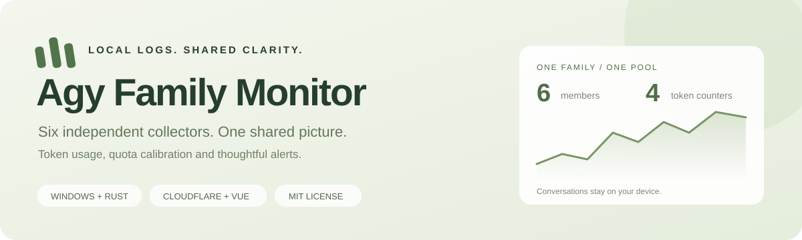
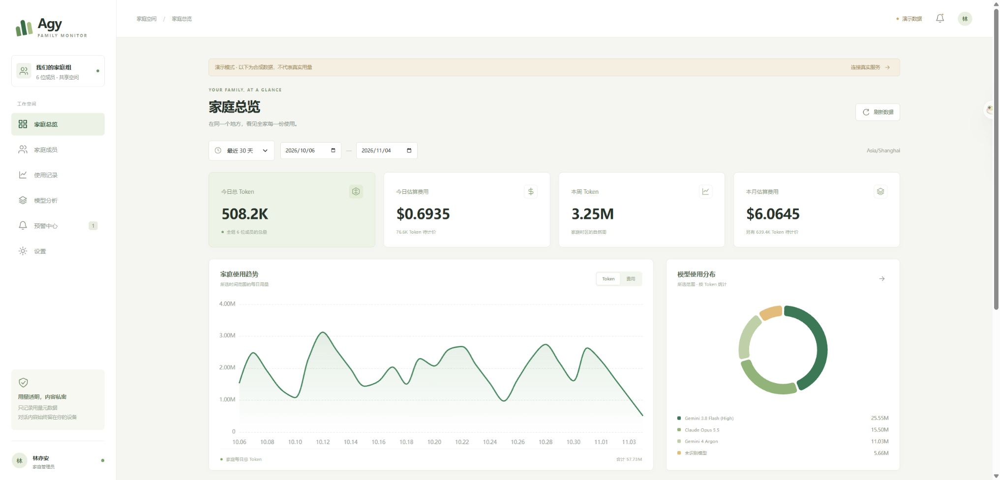
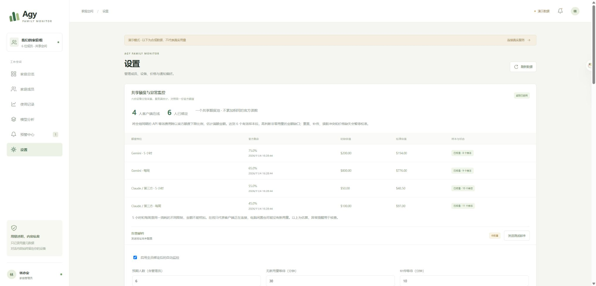
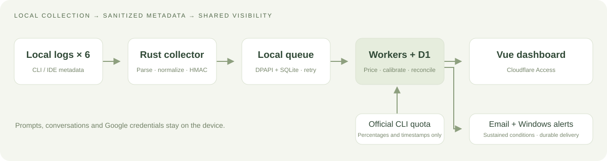

<div align="center">



# Agy Family Monitor

**Six people. One view of AI usage.**

Local Windows collection · Shared dashboard · Quota calibration · Email alerts

[简体中文](README.md) · **English**

[](LICENSE)
[](docs/INSTALLATION.md)
[](CHANGELOG.md)
[](https://github.com/yatools/agy-family-monitor/actions/workflows/checks.yml)

[Download](https://github.com/yatools/agy-family-monitor/releases/latest/download/AgyFamilyMonitor.exe) · [Quick start](#quick-start) · [Self-host](docs/DEPLOYMENT.md) · [Monitoring](docs/MONITORING.md) · [Contribute](CONTRIBUTING.md)

</div>

---

Antigravity logs live on separate computers. A family still needs a shared picture of usage.
Agy Family Monitor reads local usage metadata, adds up six members' tokens and API-equivalent costs,
and reconciles them against **one shared quota pool**. Conversations, prompts, Google credentials
and original session IDs stay on each device.



<p align="center"><sub>Six dashboard pages · Synthetic demo data only · Desktop and mobile layouts</sub></p>

## Features

|     | Feature                  | Behavior                                                                                                 |
| --- | ------------------------ | -------------------------------------------------------------------------------------------------------- |
| 🧮  | Four token counters      | Input, output, cache read and cache write; reasoning is never counted twice                              |
| 👥  | A six-person family      | One administrator and five members, independent collectors and shared usage/presence views               |
| 📊  | One pool, four limits    | Gemini and Claude/third-party 5-hour and weekly buckets; repeated official readings are never multiplied |
| 🔔  | Sustained anomaly alerts | Online clients with no new family usage, quota/log discrepancies, upload grace periods and email retries |
| 🏷️  | Traceable pricing        | Argon, Opus 5.5, Sonnet 5.5, Flash 3.8 and more, with sources, versions and effective dates              |
| 🔒  | Minimal uploads          | Device-specific HMAC, Windows DPAPI, a durable local queue, Access and server-side authorization         |

Filter by date, member, model and source. Set periodic thresholds, receive Windows notifications,
revoke devices, replay offline queues and update corrected steps. Unknown prices remain **unpriced**.

<details>
<summary><strong>Shared quota monitoring preview</strong></summary>



Automatic monitoring arms after all six active members have a bound device. Clients send a heartbeat
every minute and poll official quotas every five minutes. Nonzero cost gaps require at least six
valid calibration samples before they can trigger a discrepancy alert.

</details>

## Quick start

### Join an existing family

You need Windows 10/11 x64 and a one-time enrollment code from your administrator.
Download the [Windows client](https://github.com/yatools/agy-family-monitor/releases/latest/download/AgyFamilyMonitor.exe), then run:

```powershell
.\AgyFamilyMonitor.exe --enroll
.\AgyFamilyMonitor.exe --install
.\AgyFamilyMonitor.exe --background
```

Enter the code interactively. It expires after 15 minutes and can only be used once.
DPAPI protects credentials for the current Windows user. Running the client requires no Node.js,
Python, Docker or CC Switch installation.

For your own server, replace the first command with:

```powershell
.\AgyFamilyMonitor.exe --enroll --server https://agent-monitor.example.com
```

The maintainer's instance at [token.lupages.com](https://token.lupages.com) uses an Access allowlist
and has no public registration. The downloadable client defaults to that instance; pass your own
`--server` when self-hosting.

### Enable real quota calibration

Upgrade all six collectors to 0.2.0. Install and sign in to the official Antigravity CLI on at least
one computer, then check detection:

```powershell
.\AgyFamilyMonitor.exe --check-quota
```

The collector invokes the official CLI's `/usage` command and keeps only four quota percentages
and timestamps. It does not read Google credentials. Token statistics work without a quota reader;
calibration waits for real readings.

Initial full-pool estimates are **Gemini: $200 / 5h, $800 / week** and
**Claude/third-party: $50 / 5h, $100 / week**. These are shared estimates, not per-member allocations.
Five-hour and weekly limits overlap and must not be added together. See the [monitoring guide](docs/MONITORING.md).

## Build from source

Use Windows x64, Rust 1.98+ with a C/C++ build toolchain, Node.js 24 and npm 11.

```powershell
git clone https://github.com/yatools/agy-family-monitor.git
cd agy-family-monitor
npm ci
Copy-Item apps/worker/wrangler.example.jsonc apps/worker/wrangler.jsonc
./scripts/check.ps1
./scripts/build-agent.ps1
npm run dev:web
```

Open `http://localhost:5173/?demo=1` for a six-person synthetic demo without cloud credentials.
For real local API development, run `npm run dev` in another terminal. Configure your own D1,
domains and Access application before deployment. The [deployment guide](docs/DEPLOYMENT.md)
covers setup; detailed engineering documents are currently primarily in Chinese.
Local `wrangler.jsonc`, `.local`, backups and real member data are excluded from Git.

<details>
<summary>Windows Cargo downloads or non-ASCII build paths</summary>

```powershell
node scripts/fetch-rust.mjs fetch --locked
./scripts/check.ps1 -RegistryFallback
./scripts/build-agent.ps1 -RegistryFallback
```

The download helper retains Cargo integrity checks without changing global configuration.
Rust build output uses a temporary directory to avoid GNU linker limitations with non-ASCII paths.

</details>

## Architecture



| Directory                       | Responsibility                                                                               |
| ------------------------------- | -------------------------------------------------------------------------------------------- |
| `crates/agy-usage-core`         | Discovery, parsing, model recovery, normalization and pseudonymization; independent of Tauri |
| `agent`                         | Windows collection, queue, uploads, quota polling, notifications and startup tasks           |
| `apps/worker`                   | Hono API, authorization, D1, integer pricing, calibration and email queue                    |
| `apps/web`                      | Vue 3, TypeScript, ECharts and six dashboard pages                                           |
| `fixtures` / `docs` / `scripts` | Synthetic fixtures, engineering documentation and operations tools                           |

## Validation and status

Local validation on November 4, 2026: **91 tests passed**, plus Rust formatting, Clippy,
TypeScript checks, production bundling and a Windows release build.
Real Windows / CC Switch reconciliation matched **73 sessions and 1,776 events** with no counter or model differences.
Cloudflare email delivery was confirmed by the recipient.

Two independent Windows collectors, six real members' permissions and a six-device 72-hour run
still need acceptance testing. Real quota sampling and long-term calibration require enrolled devices.
See [acceptance records](docs/ACCEPTANCE.md) for evidence and pending work.
The CI badge reports actual GitHub workflow status.

## Boundaries

API-equivalent cost is an estimate, not an official bill. Online means the collector is connected,
not that a model is currently in use. Alerts help investigate collection and estimation; they are
not evidence of misuse. Collect each session on one device only: copied logs cannot be deduplicated
automatically across devices. This project observes usage; it does not provide an AI proxy,
credential sharing or quota resale.

## Documentation and contributing

[Install / upgrade](docs/INSTALLATION.md) · [Deploy](docs/DEPLOYMENT.md) · [Monitoring / pricing](docs/MONITORING.md) ·
[API](docs/API.md) · [Architecture](docs/ARCHITECTURE.md) · [Privacy](docs/PRIVACY.md) · [Specification](SPEC.md)

Open an [issue](https://github.com/yatools/agy-family-monitor/issues) or follow the
[contributing guide](CONTRIBUTING.md) to submit a pull request. Use synthetic data in reports.
For security concerns, see [SECURITY.md](SECURITY.md).

## License and acknowledgments

[MIT License](LICENSE). Selected read-only parsing behavior is adapted from
[CC Switch](https://github.com/farion1231/cc-switch), pinned to
`51fce968bca807aeee93be9420c651afb582c2c8`. **Copyright © 2025 Jason Young** and the full
upstream MIT license are preserved in [third-party notices](THIRD_PARTY_NOTICES.md).

The language switch and quick navigation take layout inspiration from CC Switch; compact
documentation links take inspiration from [shadcn/ui](https://github.com/shadcn-ui/ui).
The cover, screenshots and wording were created for this project.
