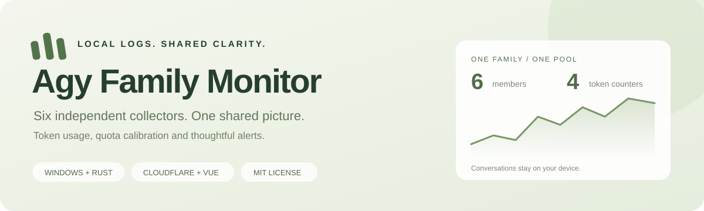
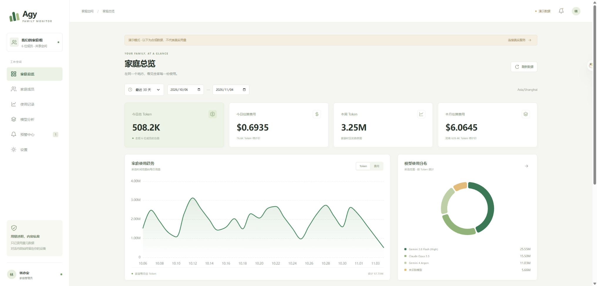
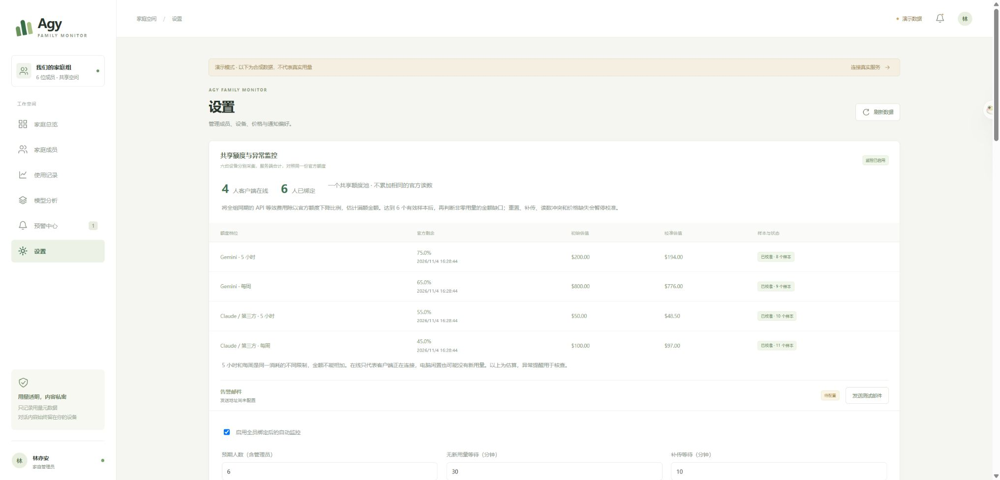
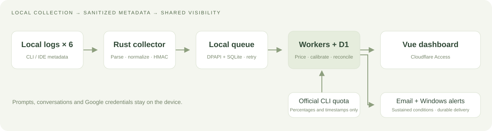

<div align="center">



# Agy Family Monitor

**六个人的 AI 用量，一个清楚的视图。**

Windows 本地采集 · 家庭组共享仪表盘 · 额度校准 · 异常邮件

**简体中文** · [English](README.en.md)

[](LICENSE)
[](docs/INSTALLATION.md)
[](CHANGELOG.md)
[](https://github.com/yatools/agy-family-monitor/actions/workflows/checks.yml)

[下载客户端](https://github.com/yatools/agy-family-monitor/releases/latest/download/AgyFamilyMonitor.exe) · [快速开始](#快速开始) · [自行部署](docs/DEPLOYMENT.md) · [监控说明](docs/MONITORING.md) · [参与贡献](CONTRIBUTING.md)

</div>

---

Antigravity 的记录留在各自电脑上，家庭组却需要一份共同的用量视图。
Agy Family Monitor 只读取本地用量元数据，将六人的 Token 与 API 等效费用合计，
再与**同一个共享额度池**对账。对话、提示词、Google 凭据和原始会话标识留在本机。



<p align="center"><sub>六页仪表盘 · 截图仅含合成演示数据 · 桌面与手机布局</sub></p>

## 能做什么

|     | 功能                 | 具体行为                                                            |
| --- | -------------------- | ------------------------------------------------------------------- |
| 🧮  | 四类 Token，分别统计 | Input、Output、Cache Read、Cache Write；reasoning 不重复累加        |
| 👥  | 六人共享查看         | 管理员加五名成员，各电脑独立采集，全组可看统计与在线状态            |
| 📊  | 一套额度，四档校准   | Gemini / Claude·第三方，各自 5 小时与周限；相同官方读数只计一次     |
| 🔔  | 持续异常才提醒       | 在线但全组无新用量、官方额度下降与日志缺口，支持补传宽限和邮件重试  |
| 🏷️  | 可追溯的价格         | Argon、Opus 5.5、Sonnet 5.5、Flash 3.8 等；保留来源、版本与生效时间 |
| 🔒  | 最少数据上传         | 设备专属 HMAC、Windows DPAPI、本地持久队列、Access 与服务端权限校验 |

还包括日期/成员/模型/来源筛选、周期预警、Windows 通知、设备撤销、离线补传、
Step 修正和备份恢复。未知价格保留为“待计价”，不会当成免费。

<details>
<summary><strong>查看共享额度监控</strong></summary>



六名活动成员均绑定后才启用自动监控。每分钟心跳、每五分钟读取官方额度；
积累至少六个有效样本后，再判断非零用量的金额缺口。

</details>

## 快速开始

### 加入已有家庭组

需要 Windows 10/11 x64，以及管理员在网站生成的一次性绑定码。
下载 [Windows 客户端](https://github.com/yatools/agy-family-monitor/releases/latest/download/AgyFamilyMonitor.exe)，在所在目录运行：

```powershell
.\AgyFamilyMonitor.exe --enroll
.\AgyFamilyMonitor.exe --install
.\AgyFamilyMonitor.exe --background
```

交互输入绑定码；15 分钟有效、只能使用一次。凭据由当前 Windows 用户的 DPAPI 保护。
客户端运行无需安装 Node.js、Python、Docker 或 CC Switch。

连接自己的服务器时，第一条改为：

```powershell
.\AgyFamilyMonitor.exe --enroll --server https://agent-monitor.example.com
```

维护者实例：[token.lupages.com](https://token.lupages.com)，通过 Access 允许列表登录，不开放公共注册。
默认客户端连接该实例；自行部署时请显式指定自己的 `--server`。

### 启用真实额度校准

六人全部使用 0.2.0 客户端，至少一台电脑安装并登录官方 Antigravity CLI：

```powershell
.\AgyFamilyMonitor.exe --check-quota
```

程序通过官方 CLI 的 `/usage` 查询，只保留四档余额比例和时间，不读取 Google 凭据。
没有额度读数时，Token 统计仍可使用，额度校准会等待数据。
初始整池估值为 Gemini **5H $200 / 周 $800**、Claude·第三方 **5H $50 / 周 $100**；
它们不是每人额度，5H 与周限也不能相加。详见[监控与校准](docs/MONITORING.md)。

## 从源码运行

开发环境：Windows x64、Rust 1.98+ 及 C/C++ 编译工具链、Node.js 24、npm 11。

```powershell
git clone https://github.com/yatools/agy-family-monitor.git
cd agy-family-monitor
npm ci
Copy-Item apps/worker/wrangler.example.jsonc apps/worker/wrangler.jsonc
./scripts/check.ps1
./scripts/build-agent.ps1
npm run dev:web
```

打开 `http://localhost:5173/?demo=1` 查看六人合成数据，无需云端账号。
真实 API 本地开发另开终端运行 `npm run dev`；部署前配置自己的 D1、域名及 Access。
[部署指南](docs/DEPLOYMENT.md)包含数据库、登录、邮件和备份步骤。
`wrangler.jsonc`、`.local`、备份和真实用户数据不提交到 Git。

<details>
<summary>Windows Rust 下载或中文路径问题</summary>

```powershell
node scripts/fetch-rust.mjs fetch --locked
./scripts/check.ps1 -RegistryFallback
./scripts/build-agent.ps1 -RegistryFallback
```

兼容下载辅助保留 Cargo 校验，不改全局配置；Rust 输出使用临时目录，避开 GNU 链接器的中文路径限制。

</details>

## 它如何工作



| 目录                            | 内容                                                  |
| ------------------------------- | ----------------------------------------------------- |
| `crates/agy-usage-core`         | 独立发现、解析、模型恢复、归一化与脱敏，无 Tauri 依赖 |
| `agent`                         | Windows 采集、队列、上传、额度查询、通知与登录任务    |
| `apps/worker`                   | Hono API、身份校验、D1、计价、校准与邮件队列          |
| `apps/web`                      | Vue 3、TypeScript、ECharts，六个页面                  |
| `fixtures` / `docs` / `scripts` | 合成数据、工程文档、构建与运维工具                    |

## 质量与当前进度

2026-11-04 本机检查：**91 项测试通过**，Rust 格式与 Clippy、TypeScript 检查、
生产打包和 Windows Release 构建通过。真实 Windows / CC Switch 对账达到 **73 个会话、1,776 个事件全匹配**。
Cloudflare 邮件已完成实际收件验证。

两台独立 Windows、六人真实权限与六台设备连续 72 小时运行仍待验收。
官方额度的真实采样和长期校准需在成员安装绑定后完成。
详见[验收记录](docs/ACCEPTANCE.md)，上方 CI 徽章反映 GitHub 的实际运行状态。

## 使用边界

API 等效费用是估算，不是官方账单。在线仅代表客户端连接，不代表模型正在使用。
缺口邮件用于核查采集和估算，不能作为违规证据。
每份会话只由一台设备采集；跨电脑复制的日志无法自动跨设备去重。
该项目提供用量观察，不提供 AI 代理、凭据共享或额度转售功能。

## 文档与贡献

[安装与升级](docs/INSTALLATION.md) · [部署运维](docs/DEPLOYMENT.md) · [监控与价格](docs/MONITORING.md) ·
[API](docs/API.md) · [架构](docs/ARCHITECTURE.md) · [隐私](docs/PRIVACY.md) · [原始规格](SPEC.md)

欢迎通过 [Issues](https://github.com/yatools/agy-family-monitor/issues) 提交问题，或按 [贡献指南](CONTRIBUTING.md) 发起 PR。
问题报告请使用合成数据；安全问题见 [SECURITY.md](SECURITY.md)。

## 许可与致谢

[MIT License](LICENSE)。部分只读解析行为参考并适配 [CC Switch](https://github.com/farion1231/cc-switch)，
固定上游提交 `51fce968bca807aeee93be9420c651afb582c2c8`，保留 **Copyright © 2025 Jason Young**
及完整 MIT 许可，详见[第三方说明](THIRD_PARTY_NOTICES.md)。

README 的语言切换与快捷导航布局参考 CC Switch，简洁的文档入口参考 [shadcn/ui](https://github.com/shadcn-ui/ui)；
封面、截图与文案为本项目独立制作。
